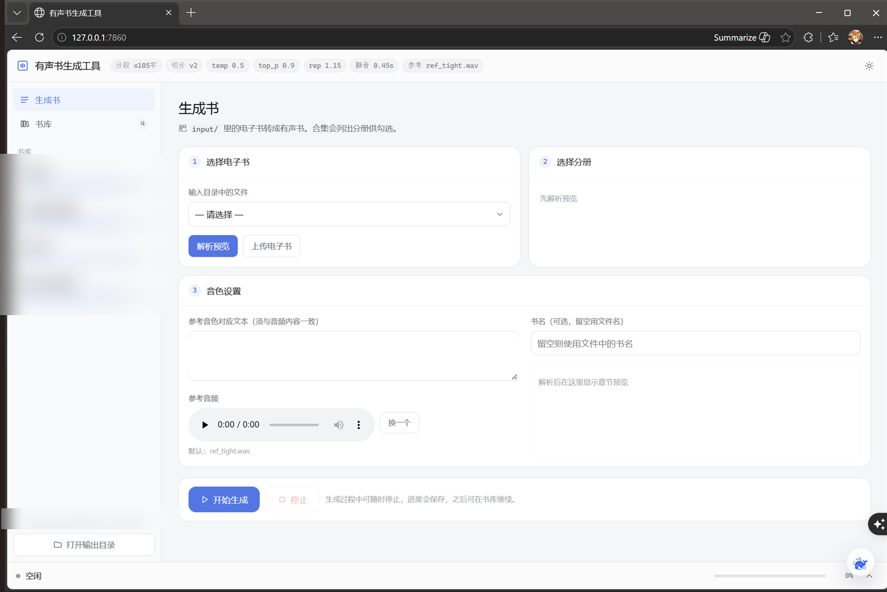
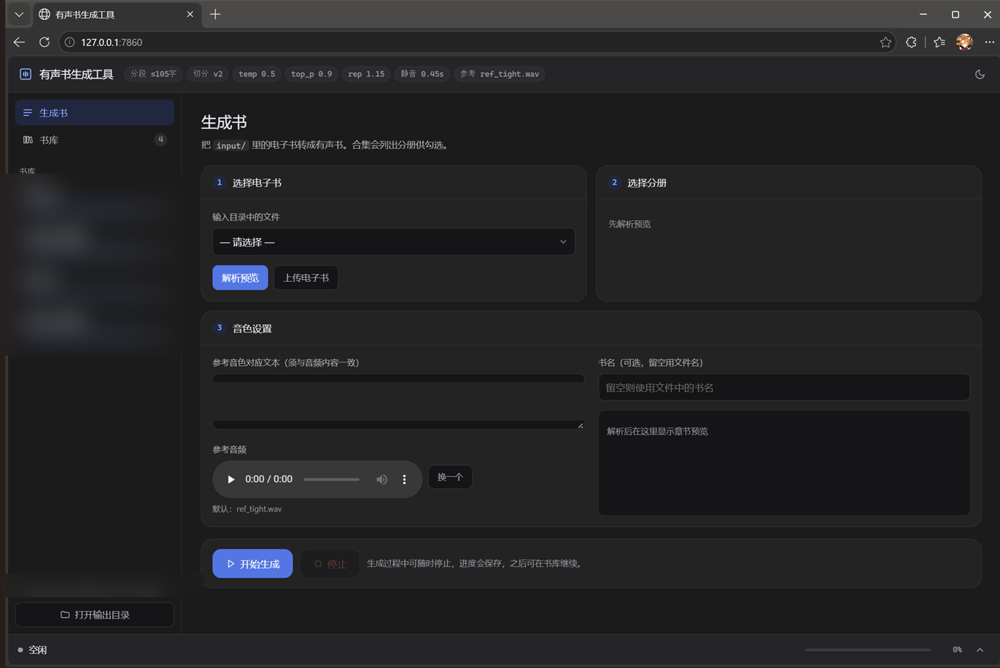
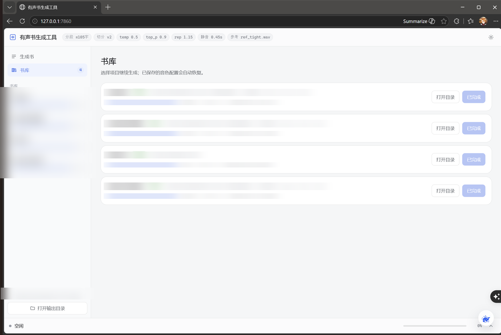

# 有声书生成工具

把电子书批量转成**克隆指定音色**的有声书。全本地运行，不上传任何内容。

> 核心不是"调用了哪个 TTS"，而是**让上千个段落听起来始终是同一个人**——
> 逐段质检、不合格自动重生成、段级断点续跑。



<details>
<summary>更多界面截图（暗色 / 书库）</summary>




</details>

---

## 特点

### 每段都过一道质检

一段合成完就查四样：整段声纹像不像参考音色、段内有没有中途换人、有没有退化成噪声、有没有「电音」（高频被过度谐波化）。不合格自动重生成，最多三次，三次都不达标就留最好的那次。

全章 526 段实测：一次误报都没有，也没触发过重生成。拿一个听感上明显「电音」的候选引擎来跑，12 段全被抓了出来。

### 参数一变，旧缓存就作废

段缓存是按段号存的。分段长度、切分算法、参考音色、采样参数，任一个变了指纹就变，旧段不再复用。这条是踩出来的：分段从 205 改到 105 之后，段号对应的文本全变了，继续复用旧段等于拿 A 的音频配 B 的字。

### 断了能接着跑

随时停，进度落盘。去书库点「继续生成」，做过的段不重做。46 章的书停十次也没关系。

### 参数都是测出来的

`config.py` 里每个数值旁边都写着怎么测的。比如采样用 `temp 0.5 / top_p 0.9 / rep 1.15`，不用库默认的 `0.9 / 1.0 / 1.05`——后者是追多样性的探索配置，对「上千段要像同一个人」正好是反的：标准差从 ±0.011 涨到 ±0.036，还出过 127.9 秒的撞顶失控段。

### 放哪都能跑

模型权重、ffmpeg、声纹模型的路径按四级找：环境变量 → 项目内约定位置 → 发行包内约定位置 → 系统 PATH（另外可以用 `AUDIOBOOK_DEV_ROOT` 兜底开发机上的老位置）。换电脑、放任何目录都不用改代码，仓库里没有硬编码的机器路径。

---

## 支持格式

用 258 个真实文件（7.51 GB）实测过：

| 格式 | 结果 |
|---|---|
| **EPUB**（含多册合集、KF8） | ✅ 120 个 |
| **MOBI**（Mobipocket 7 与 KF8） | ✅ 23 个 |
| **AZW3** | ✅ 2 个 |
| **TXT** | ✅ 整本作为一章（纯文本没有可靠章节标记，不硬猜） |
| 漫画 / 画集 | 🎨 自动识别并跳过（42 个） |
| PDF | ➖ 未支持 |
| RAR / DJVU | ⬜ 未支持（需要额外的外部工具） |

**识别漫画的判据**：图片占文件体积过半 **且** 文字量少于 2 万字。
只靠体积比会误伤轻小说（正文 + 十几张彩插，图片同样占 90%+）。

> 逐文件的测试清单（含具体书名）不随仓库发布，避免公开个人书库目录；
> 汇总结果见 `tts_eval/reports/`。想自己复现就指向你自己的书库目录：
> `python scripts/challenge_library.py <目录>`

---

## 快速开始

### 环境要求

| 项 | 要求 |
|---|---|
| 系统 | Windows 10/11 |
| 显卡 | **NVIDIA，显存 ≥ 6GB**（CPU 能跑但慢到不可用） |
| Python | 3.12 |
| 磁盘 | ≥ 20GB |

### 安装

```powershell
# 建 venv、装依赖、下模型（约 2.3GB）、自检
powershell -ExecutionPolicy Bypass -File .\setup.ps1

# 顺便验证模型能出声
powershell -ExecutionPolicy Bypass -File .\setup.ps1 -SelfTest
```

### 运行

```powershell
# 在仓库根目录（audiobook_tool/）执行
python server.py
# → http://127.0.0.1:7860
```

把电子书放进 `input/`（或直接在界面上传）→ 选择 → 解析预览 →
勾选分册 → 开始生成。合集默认全选，**只想做一本记得取消其余勾选**。

### 关于参考音色

默认用 `reference_audio/ref_tight.wav`。也可以在界面上传任意
**5~10 秒的单人干净语音**来克隆别的音色，并填入那段语音的**准确文字**
（ICL 克隆模式下文字错了音色会飘）。

参考音频对应的文字有三种给法（优先级从高到低）：

| 方式 | 说明 |
|---|---|
| 环境变量 `AUDIOBOOK_REF_TEXT` | 临时切换最方便 |
| `reference_audio/ref_text.txt` | 推荐：一个纯文本文件，和音频放一起 |
| 界面输入框 | 单次生成时手填 |

> 仓库里**不内置任何参考台词**——它必须和你的参考音频逐字一致，
> 所以只能由你提供。

经验：只要**一段连续语音**、**先剪掉静音**；不是越长越好
（实测 10.6 秒的拼接版比 6.08 秒的单段版更差）。

> ⚠️ 参考音频属于素材版权范畴，本仓库不附带。请自备，并自行确认授权情况。
> 请勿克隆他人声音用于冒充、欺骗或任何违法用途。

---

## 输出

```
output/<书名>/
    <书名>_ch01_第一章.mp3     每章一个 mp3
    <书名>_全书.mp3            整本拼接
    <书名>_播放清单.m3u
    _chunks/                   段级缓存（断点续跑用，别删）
    task_state.json            进度与生效配置
```

---

## 命令行工具

| 脚本 | 用途 |
|---|---|
| `scripts/regen_chapter.py` | 单章重做（段级断点续跑 + 质检门） |
| `scripts/consistency_audit2.py` | **段间漂移审计**：找出"听着偏离"的段 |
| `scripts/verify_parse.py` | 电子书解析回归测试 |
| `scripts/challenge_library.py` | 批量挑战整个书库，识别漫画、汇总失败 |
| `scripts/smoke_test_engine.py` | 改完代码的端到端冒烟测试 |

---

## 文档

| 文件 | 内容 |
|---|---|
| **[AGENTS.md](AGENTS.md)** | **改代码前必读**：铁律、已知陷阱、启发式翻车案例 |
| [docs/AGENT_HANDOVER.md](docs/AGENT_HANDOVER.md) | 交接主文档：架构、数据契约、实测基准、评测方法 |
| [docs/DESIGN.md](docs/DESIGN.md) | 界面设计规范 |
| [tts_eval/README.md](tts_eval/README.md) | 已否决的 6 个引擎、**3 个会让指标骗人的陷阱** |
| [tts_eval/reports/baseline.md](tts_eval/reports/baseline.md) | 当前采纳的声音基准（全章 526 段实测数据） |

---

## 技术栈

Qwen3-TTS-12Hz-0.6B-Base（Apache-2.0）· CAM++ 声纹（Apache-2.0）·
FastAPI + 原生前端 · ffmpeg

## License

[MIT](LICENSE) © 2026 stellifex

第三方组件（Qwen3-TTS / CAM++ / ffmpeg）的授权与使用须知见
[THIRD_PARTY_NOTICES.md](THIRD_PARTY_NOTICES.md)。

**请勿将本工具用于未经授权的声音克隆、冒充他人或其他违法用途。**
